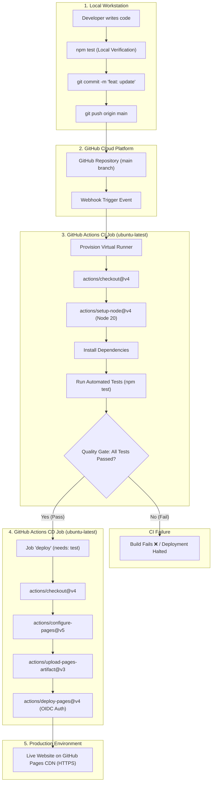

# GitHub-Based Automated CI/CD Pipeline
### DevOps CI/CD Automation Dashboard


---

## 1. Project Title
**GitHub-Based Automated CI/CD Pipeline**  
*Sub-title:* Automated Testing and Zero-Downtime Deployment of a Modern Web Dashboard using GitHub Actions and GitHub Pages.

---

## 2. Abstract
Modern software engineering requires rapid, reliable, and frequent software releases. Manual deployment methodologies often suffer from human error, environment inconsistencies ("it works on my machine"), and prolonged downtime. 

This project demonstrates a production-grade, end-to-end **Continuous Integration and Continuous Deployment (CI/CD)** pipeline built entirely upon **Git**, **GitHub**, **GitHub Actions**, and **GitHub Pages**. The application is a responsive engineering dashboard designed with semantic HTML5, modern CSS3, and vanilla JavaScript. Whenever a developer pushes code or creates a Pull Request targeting the `main` branch, GitHub Actions automatically provisions an isolated virtual runner, configures the Node.js runtime, executes 31 comprehensive automated validation tests, and securely publishes the live website to GitHub Pages without human intervention or secret token exposure.

---

## 3. Problem Statement
In traditional software development and legacy academic workflows:
1. **Manual File Transfers:** Developers deploy applications via manual FTP or SSH connections, leaving room for missed files and corrupted builds.
2. **Untested Deployments:** Code is frequently pushed directly to live servers without automated test verification, causing unexpected runtime crashes.
3. **Environment Inconsistency:** Code that executes correctly on a developer's workstation frequently fails in production due to configuration discrepancies.
4. **Lack of Traceability:** Teams cannot easily correlate which specific commit or developer caused a regression or when a specific bug was introduced.

---

## 4. Objectives
- **Automate the Build and Test Cycle:** Trigger automated tests on every code push and pull request.
- **Implement Strict Quality Gates:** Physically prevent broken code from being deployed by decoupling the CI test job from the CD deployment job.
- **Achieve Zero-Downtime Continuous Deployment:** Automatically publish verified builds directly to GitHub Pages CDN.
- **Eliminate Secret Credential Exposure:** Utilize GitHub Actions OpenID Connect (OIDC) permissions instead of hardcoded tokens or passwords.
- **Provide an Interactive Visual Learning Platform:** Deliver a dashboard equipped with a real-time CI/CD execution simulator and architectural walkthrough suitable for academic evaluation.

---

## 5. Introduction to DevOps
**DevOps** is a compound of **Development (Dev)** and **Operations (Ops)**. It represents a cultural philosophy, collaborative practice, and toolchain designed to shorten the systems development life cycle while delivering features, fixes, and updates frequently in close alignment with business objectives.

```
       [ PLAN ]  --->  [ CODE ]  --->  [ BUILD ]
          ^                                |
          |                                v
      [ MONITOR ]                     [ TEST (CI) ]
          ^                                |
          |                                v
      [ OPERATE ] <--- [ DEPLOY (CD) ] <--- [ RELEASE ]
```

### The Four Pillars of DevOps
1. **Collaboration:** Developers and operations engineers work together using shared tools and version control.
2. **Automation:** Repetitive tasks (testing, packaging, releasing) are automated using workflows.
3. **Continuous Improvement:** Frequent small releases provide rapid user feedback loops.
4. **Infrastructure as Code (IaC):** Pipelines and environments are defined in declarative code files (e.g., YAML).

---

## 6. Continuous Integration (CI) Explanation
**Continuous Integration (CI)** is the software engineering practice where members of a team integrate their work into a shared mainline repository frequently (usually multiple times per day).

Each integration is verified by an automated build and automated test suite:
1. **Developer Commits Code:** Code revisions are pushed to a remote GitHub repository.
2. **Webhook Event:** GitHub detects the commit and broadcasts an internal trigger event.
3. **Automated Runner Provisioning:** A containerized runner (`ubuntu-latest`) spins up in seconds.
4. **Automated Testing:** 
   - Unit tests run against application functions.
   - HTML semantic and DOM tags are validated.
   - CSS variables and responsive rules are confirmed.
   - Workflow YAML schema rules are verified.
5. **Fast Feedback:** If any test fails, the build halts immediately, flagging the commit with a red cross (❌) and sending instant notifications to developers.

---

## 7. Continuous Deployment (CD) Explanation
**Continuous Deployment (CD)** is the logical evolution of Continuous Integration. Every change that passes all stages of your production pipeline is released automatically directly to end users with zero manual intervention.

### Comparing CI vs. Delivery vs. Deployment

| Stage | What Happens? | Deployment Decision |
| :--- | :--- | :--- |
| **Continuous Integration (CI)** | Code is compiled and tested automatically on every commit. | None (Code verified only). |
| **Continuous Delivery (CD)** | Code is tested and built into a deployable release artifact. | Manual human approval required to release. |
| **Continuous Deployment (CD)** | Code is tested and automatically published to production. | **100% Automated** (No human gate). |

In this project, once the CI test suite passes on the `main` branch, the deployment job automatically packages the web artifacts and deploys them to **GitHub Pages**.

---

## 8. Technologies Used

- **HTML5:** Semantic document structure, accessibility landmarks (`header`, `main`, `section`, `nav`, `footer`).
- **CSS3:** Modern CSS custom properties (variables), Flexbox, CSS Grid, Glassmorphism, animations, and responsive media queries.
- **JavaScript (Vanilla ES6+):** Interactive workflow node inspector, DOM event listeners, and real-time step-by-step CI/CD execution simulator.
- **Git:** Distributed Version Control System (VCS) for local change tracking and branching.
- **GitHub:** Cloud-based code host, Git repository management, Pull Request collaboration, and webhook event dispatching.
- **GitHub Actions:** Cloud orchestration workflow engine running automated jobs on virtual runners (`ubuntu-latest`).
- **GitHub Pages:** High-performance, globally distributed Content Delivery Network (CDN) providing static website hosting with automated HTTPS.
- **Node.js (Built-in Test Runner `node:test`):** Lightweight, zero-dependency automated testing engine for running fast assertions.

---

## 9. System Architecture



---

## 10. Workflow Explanation

The pipeline consists of two decoupled sequential jobs defined in `.github/workflows/deploy.yml`:

### Stage 1: Continuous Integration (`test` Job)
- **Environment:** `ubuntu-latest`
- **Steps:**
  1. Clones repository files via `actions/checkout@v4`.
  2. Sets up Node.js runtime environment via `actions/setup-node@v4`.
  3. Verifies dependencies (`npm ci || npm install`).
  4. Runs automated tests via `npm test` (`node --test tests/*.test.js`).
  5. Evaluates 31 test assertions across HTML, CSS, JavaScript, and Workflow YAML.

### Stage 2: Continuous Deployment (`deploy` Job)
- **Dependency:** `needs: test` (will NOT execute if Stage 1 fails).
- **Condition:** `if: github.ref == 'refs/heads/main' && github.event_name != 'pull_request'`
- **Environment:** `ubuntu-latest`, targeting GitHub Pages environment.
- **Permissions:** `pages: write`, `id-token: write`, `contents: read`.
- **Steps:**
  1. Clones the verified source code.
  2. Configures Pages endpoints using `actions/configure-pages@v5`.
  3. Archives the static website into a deployment tarball with `actions/upload-pages-artifact@v3`.
  4. Publishes to GitHub Pages global CDN edge servers using `actions/deploy-pages@v4`.

---

## 11. Project Structure

```
CICD/
├── .github/
│   └── workflows/
│       └── deploy.yml        # GitHub Actions CI/CD declarative pipeline workflow
├── tests/
│   ├── html.test.js          # Automated tests for HTML5 semantics & required sections
│   ├── css.test.js           # Automated tests for CSS variables & responsive rules
│   ├── javascript.test.js    # Automated tests for JS simulator logic & time functions
│   └── workflow.test.js      # Automated tests for CI/CD YAML schema & security rules
├── .gitignore                # Git exclusions (node_modules, logs, OS files)
├── index.html                # Main responsive dashboard web application
├── style.css                 # Dark-and-blue software engineering theme styling
├── script.js                 # Interactive pipeline visualizer and execution simulator
├── package.json              # Project configuration, scripts, and Node metadata
└── README.md                 # Complete academic documentation & guide
```

---

## 12. Local Installation Instructions

### Prerequisites
- [Node.js](https://nodejs.org/) (Version 18.x, 20.x, or 22.x LTS installed).
- [Git](https://git-scm.com/) installed on your computer.

### Step-by-Step Local Setup
1. Open your terminal (PowerShell, Command Prompt, or Bash).
2. Clone or open the project directory:
   ```bash
   cd c:\Users\admin\Desktop\CICD
   ```
3. Run the automated test suite locally:
   ```bash
   npm test
   ```
4. Start the local preview web server:
   ```bash
   npm start
   ```
5. Open your web browser and navigate to:
   ```
   http://localhost:3000
   ```

---

## 13. GitHub Setup Instructions

Follow these exact steps to host this project on your personal GitHub account:

### Step 1: Initialize Git and Commit
```bash
git init
git add .
git commit -m "feat: complete automated CI/CD pipeline dashboard"
git branch -M main
```

### Step 2: Create a New GitHub Repository
1. Log in to [GitHub](https://github.com).
2. In the top-right corner, click **+** and select **New repository**.
3. Name your repository (e.g., `devops-cicd-pipeline`).
4. Set visibility to **Public** (required for free GitHub Pages).
5. Do NOT initialize with a README, .gitignore, or license (we already created them).
6. Click **Create repository**.

### Step 3: Link Local Repository to GitHub
Copy the remote repository URL from GitHub and run:
```bash
git remote add origin https://github.com/<YOUR-USERNAME>/<YOUR-REPO-NAME>.git
git push -u origin main
```

---

## 14. GitHub Actions Configuration

The pipeline configuration file is located at `.github/workflows/deploy.yml`.

### Key Security & Reliability Declarations:
- **`permissions`:** 
  ```yaml
  permissions:
    contents: read
    pages: write
    id-token: write
  ```
  Explicitly enforces least-privilege security. It uses GitHub's internal OpenID Connect (OIDC) service to securely authenticate deployments without personal access tokens.
- **`concurrency`:** 
  ```yaml
  concurrency:
    group: "pages"
    cancel-in-progress: false
  ```
  Prevents race conditions if multiple commits are pushed in quick succession.
- **`needs: test`:** 
  Guarantees that the deployment job is never invoked unless every automated test returns an exit code of `0`.

---

## 15. GitHub Pages Deployment Instructions (Crucial Manual Step)

GitHub requires a one-time configuration setting to permit GitHub Actions to deploy directly to Pages:

1. Go to your repository on **GitHub.com**.
2. Click on **Settings** (top tab navigation).
3. In the left navigation menu, click **Pages** (under the "Code and automation" section).
4. Under **Build and deployment > Source**, click the dropdown and select:
   👉 **`GitHub Actions`**  
   *(Do NOT leave it on "Deploy from a branch")*.
5. Return to the **Actions** tab of your repository. You will see your workflow running! Once both jobs complete with green checkmarks, GitHub Pages will display your live deployment URL:
   ```
   https://<YOUR-USERNAME>.github.io/<YOUR-REPO-NAME>/
   ```

---

## 16. Testing Procedure

### Automated Tests Overview
The automated test suite uses Node.js's native test runner (`node:test`) and strict assertion module (`node:assert/strict`):

1. **HTML Test (`tests/html.test.js`):**
   - Validates HTML5 DOCTYPE, language attribute, viewport tag, and charset.
   - Verifies all 10 required project sections are present with their designated IDs.
   - Verifies simulator control buttons (`#btn-start-sim`, `#btn-reset-sim`, `#pipeline-progress`).
2. **CSS Test (`tests/css.test.js`):**
   - Verifies the presence of dark-and-blue theme tokens (`--bg-dark`, `--primary-blue`, etc.).
   - Checks balance of CSS brackets and braces to prevent syntax corruption.
   - Validates responsive media queries (`@media (max-width: 768px)`).
3. **JavaScript Test (`tests/javascript.test.js`):**
   - Tests module loading and syntax integrity.
   - Verifies `formatTimestamp()` outputs strict `HH:MM:SS` format.
   - Verifies 7 sequential stages in `PIPELINE_STEPS` and increasing progress in `SIMULATOR_STAGES`.
   - Validates boundary conditions on `getSimulatorStage()`.
4. **Workflow Test (`tests/workflow.test.js`):**
   - Verifies YAML syntax and triggers (`push`, `pull_request`, `workflow_dispatch`).
   - Confirms presence of OIDC permissions and `needs: test` dependency gate.

### Running Tests Manually
```bash
# Standard test run
npm test

# Verbose test run with detailed spec output
npm run test:verbose
```

---

## 17. Expected Results
- **Test Output:** 31 out of 31 assertions pass with 0 failures in under 2 seconds.
- **GitHub Actions Execution Time:** Entire CI/CD pipeline completes in approximately 35–50 seconds on GitHub's hosted runners.
- **Zero Broken Deployments:** Any commit with invalid HTML tags, broken CSS braces, or failing unit tests fails during the `test` job and never reaches production.
- **Production Website:** Live, accessible worldwide via HTTPS, 100% responsive across mobile, tablet, and desktop viewports.

---

## 18. Advantages
1. **Zero Deployment Cost:** Entire pipeline runs for free on GitHub Actions and GitHub Pages.
2. **Instant Developer Feedback:** Feedback is provided within 45 seconds of running `git push`.
3. **Elimination of Human Error:** Repetitive manual file uploads are completely automated.
4. **Enhanced Security:** No SSH keys, FTP passwords, or personal access tokens are stored in code.
5. **Clear Audit Trail:** Every build is tied to a specific Git commit hash with complete terminal logs.

---

## 19. Limitations & Future Enhancements

### Current Limitations
- **Static Hosting:** GitHub Pages is optimized for frontend static assets (HTML/CSS/JS) and does not execute backend server runtimes (e.g., Python Flask, Express.js server endpoints, or SQL databases).
- **Public Repository Requirement:** On standard GitHub accounts, GitHub Pages requires a public repository unless subscribed to GitHub Pro/Team.

### Future Enhancements
1. **Containerization (Docker):** Packaging multi-container services and publishing images to GitHub Container Registry (GHCR).
2. **Dynamic Cloud Targets:** Expanding the CD stage to deploy backend microservices to AWS ECS, Google Cloud Run, or Kubernetes (EKS/GKE).
3. **Automated End-to-End (E2E) Browser Testing:** Integrating headless Playwright or Cypress tests into the CI workflow.
4. **Security Vulnerability Scanning:** Adding automated dependency scanning (`npm audit`) and static application security testing (SAST) via CodeQL.

---

## 20. Conclusion
This project successfully establishes an automated, production-grade DevOps CI/CD pipeline. By replacing error-prone manual deployment practices with declarative GitHub Actions workflows and comprehensive automated tests, software delivery is transformed into a continuous, safe, and instantaneous engineering process. The interactive dashboard serves as both a live production artifact and an educational showcase of modern DevOps methodologies.
